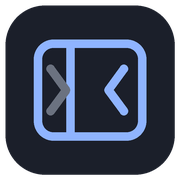
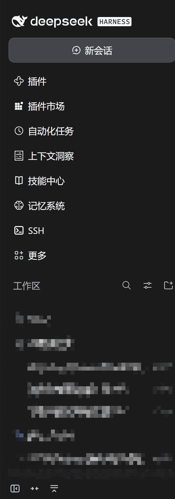
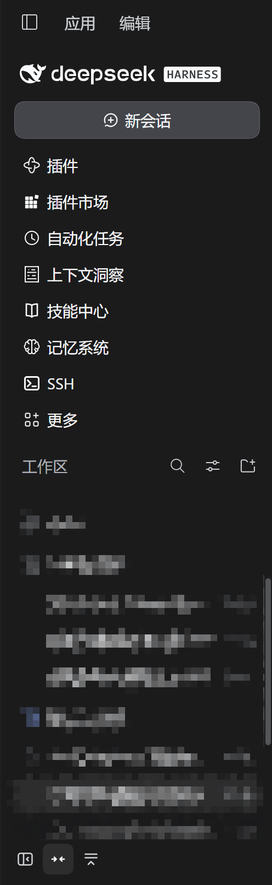
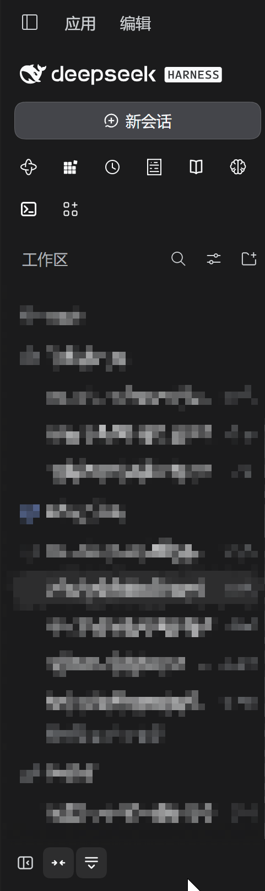

# dsh-sidebar-compact 

给 DeepSeek Harness 的左侧栏加一个可收起的紧凑模式：侧栏变窄、行距收紧，面板列表能折成一排图标，把被侧栏占掉的工作区空间还回来。

[](https://www.npmjs.com/package/@teyvat0/dsh-sidebar-compact)
[](LICENSE)

## 效果

<p align="center">
  
  
  
  <br>
  <em>左：默认 280px ｜ 中：紧凑 248px ｜ 右：面板折成两排图标</em>
</p>

## 功能

- **一键收起**：侧栏整列收成 56px 窄条，再点一下展开。
- **紧凑模式**：宽度 280 → 248px，行距 36 → 32px，新会话按钮 38 → 34px。
- **面板折叠**：插件、技能中心、SSH 等面板项折成两排 34px 图标，纵向省出约 300px。
- **状态记忆**：两个开关都会记住，刷新和重启都不丢。
- **随时还原**：关掉紧凑模式即恢复默认宽度与行距，不修改宿主的任何文件。

> 宿主本身已支持 `Ctrl / Cmd + B` 收起侧栏，插件没有重复绑定，两个入口行为一致。

## 安装

支持 DeepSeek Harness 桌面版与 Web 版。

```bash
git clone https://github.com/Teyvat0/dsh-sidebar-compact.git
```

1. 左侧栏「插件」→ 右上角「+」→「安装第三方插件」；
2. 选「本地目录」，选中克隆下来的 `dsh-sidebar-compact` 文件夹；
3. 按提示重启，或 `Ctrl + R` 刷新。

## 使用

装好后侧栏底部会多三个按钮：

| 按钮 | 作用 |
| --- | --- |
| 收起 / 展开 | 侧栏整列在默认宽度与 56px 窄条之间切换 |
| 紧凑模式 | 切换 248px 宽度与 32px 行距，关掉立即还原 |
| 折叠面板 | 面板列表在「完整列表」与「两排图标」之间切换 |

按钮悬停有说明气泡；面板折成图标后，悬停图标可以看到面板名。

## 配置

开箱即用，无需配置。状态存在浏览器 localStorage：

| 键 | 取值 |
| --- | --- |
| `dsh-sidebar-compact.mode` | `on` / `off` |
| `dsh-sidebar-compact.panels` | `folded` / `open` |

## 已知限制

- 紧凑宽度通过改写外壳网格的第一条轨道实现；手动拖拽侧栏后松手会回到 248px，关掉紧凑模式才会还你自定义宽度。
- 折叠面板依赖侧栏的类名后缀（如 `_panelList`），宿主大改版后可能需要适配。
- 只作用于 Web 端左侧栏，不影响终端、右侧栏等其他区域。

## 许可

[MIT](LICENSE)
