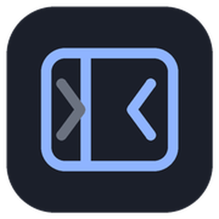

# dsh-sidebar-compact

给 DeepSeek Harness 的左侧栏加一个「紧凑模式」：侧栏变窄、行距收紧，底栏多三个按钮，随时收起侧栏或把面板列表折成一排图标，把空间还给工作区。



## 有什么用

底栏（设置图标左边）多了三个按钮：

| 按钮 | 作用 |
| --- | --- |
| 收起 / 展开 | 侧栏整列收起成 56px 窄条，再点展开 |
| 紧凑模式 | 侧栏宽度 280 → 248，面板行 36 → 32px；关掉立刻还原 |
| 折叠面板 | 把「插件 … SSH」这 10 项折成两排 34px 图标，纵向省出约 300px 给工作区 |

- 两个开关都会记住（localStorage），刷新后保持上次状态。
- 开着右侧栏时紧凑宽度同样生效。
- 所有按钮都有自绘提示气泡（显示在按钮上方，不会被窗口边缘裁掉）。
- 宿主本来就有 `Ctrl/Cmd + B` 收起侧栏，本插件不重复绑定。

## 安装

```bash
git clone https://github.com/Teyvat0/dsh-sidebar-compact.git
```

然后在 DSH 里：

1. 左侧栏「插件」→ 右上角「+」→「安装第三方插件」；
2. 选「本地目录」，选中克隆下来的 `dsh-sidebar-compact` 文件夹；
3. 按提示重启（或 `Ctrl + R` 刷新页面）。

也可以直接让 Agent 装：

```
plugin_manager install_bundle target="<绝对路径>/dsh-sidebar-compact"
```

## 卸载

在「插件」面板里禁用或移除 `dsh-sidebar-compact` 即可，侧栏回到默认样式。

## 许可

MIT
